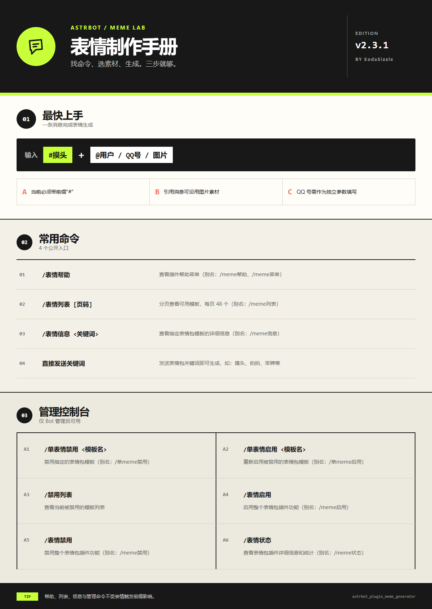
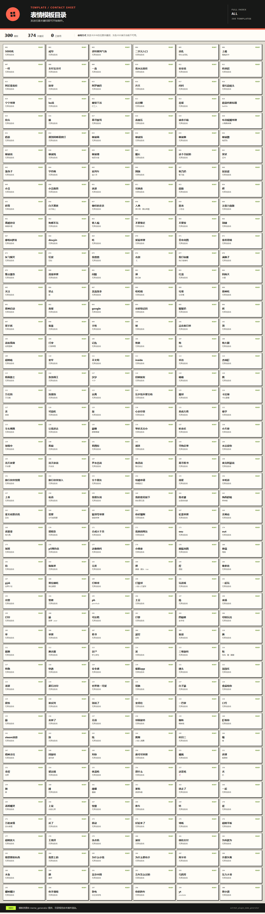
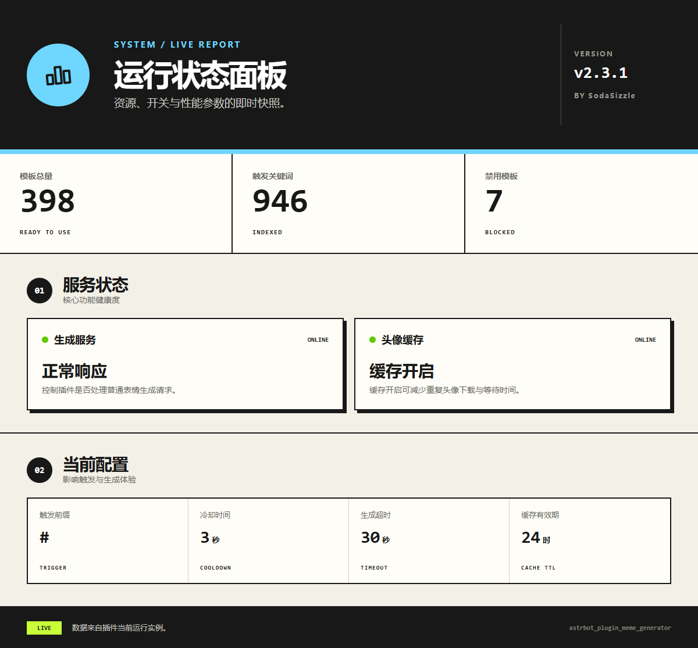

<div align="center">


# AstrBot 表情包生成插件

**v2.4.0 · 关键词触发 · QQ 头像 · 戳一戳随机表情 · GIF 工具箱**

基于 [meme-generator-rs](https://github.com/MemeCrafters/meme-generator-rs) 的 AstrBot 表情包插件。

戳一戳随机表情功能由 顾拾柒（olinl17）二次修改。

</div>

## 功能

- 发送模板关键词即可生成表情包。
- 使用 `/随机表情` 随机抽取一张表情；回复会同时附上可复用的模板指令。
- 支持 `@用户`、QQ 号、图片、文本和引用消息。
- 支持触发前缀、生成冷却、头像缓存和生成超时配置。
- 管理员可以禁用单个模板或停用整个插件。
- 内置 GIF 工具箱：动图变速/倒放/分解/网格裁剪、图片转线稿、表情包做旧、多张表情合成、视频转动图。
- QQ 群：`771954725`
- 问题反馈：[GitHub Issues](https://github.com/SodaSizzle/astrbot_plugin_meme_generator/issues)


如果这个插件对你有帮助，欢迎点一个 Star。
## 生成效果示例


## 菜单预览

### 帮助菜单



### 模板目录



### 运行状态



## 安装

在 AstrBot 插件目录中克隆仓库并安装依赖：

```bash
cd AstrBot/data/plugins
git clone https://github.com/SodaSizzle/astrbot_plugin_meme_generator
pip install -r astrbot_plugin_meme_generator/requirements.txt
```

安装或更新后，请重载插件或重启 AstrBot。

`Pillow` 与 `aiohttp` 是 GIF 工具箱的基础依赖，AstrBot 运行环境通常已内置。`imageio` 和 `imageio-ffmpeg` **只有「视频转gif」需要**（并依赖 ffmpeg）；缺失时该指令会提示不可用，其余功能不受影响，启动日志会给出告警。

## 使用方式

### 生成表情

```text
摸头
摸头 @某人
摸头 2352938756
举牌 你好世界
```

QQ 号必须作为独立参数填写，例如 `摸头 2352938756`。直接填写机器人自身 QQ 号同样有效。

如果配置了 `trigger_prefix`，则需要在关键词前添加该前缀。例如前缀为 `#`：

```text
#摸头 2352938756
```

不建议让插件的 `trigger_prefix` 与 AstrBot 全局唤醒前缀相同，否则消息可能先进入对话处理流程。

### 基础命令

| 命令 | 别名 | 说明 |
|---|---|---|
| `/表情帮助` | `/meme帮助`、`/meme菜单` | 查看新版帮助菜单 |
| `/表情列表` | `/meme列表` | 一次性查看全部模板 |
| `/表情信息 <关键词>` | `/meme信息 <关键词>` | 查看模板名称、别名、参数和标签 |
| `<关键词> [参数]` | — | 直接生成表情包 |

模板目录示例：

```text
/表情列表
/meme列表
```

目录卡片使用第一个可触发关键词作为标题，不再显示 `raise_sign`、`petpet` 等内部英文模板 key。

### GIF 工具箱

**不需要唤醒前缀**：直接发 `加速5` 就能触发，`/加速 5`、`@机器人 加速5` 同样有效。这批指令走 `@filter.regex` 而不是 `@filter.command`——后者的 `predetermine` 要求 `event.is_at_or_wake_command`，裸发的消息会被直接挡掉。

先给素材，再发指令：直接和图片一起发送、引用一条含图消息，或使用合并转发。处理结果**只回图片，不带说明文字**；只有在拿不到素材、素材不是动图等情况下才会回一句提示。

| 功能 | 写法示例 | 说明 |
|---|---|---|
| 变速 | `变速` `变速2x` `变速30fps` `30fps变速` `3倍速` `调速` | 倍速或指定帧率；超过 50fps 自动抽帧 |
| 加速 | `加速` `加速5` `5倍加速` `gif加速5` `帮我加速一下` | 默认 2 倍速 |
| 减速 | `减速3` `3倍减速` `慢放` `放慢2倍` | 默认放慢到 1/2 |
| 倒放 | `倒放` `gif倒放` `倒着放` `把这个gif倒放` | 帧序与逐帧时长一起反转，保留透明区域 |
| 分解 | `分解` `拆帧` `拆开` | 拆成逐帧图片，以合并转发发送，最多 100 帧 |
| 裁剪 | `裁剪3x4` `裁剪 3x4 边距上20` `切图` | 按网格切图，可先裁四周边距，最多 20×20 |
| 线稿 | `线稿` `转线稿` `图片转线稿` `画成素描` | 本地算法转素描线稿，不走外部接口 |
| 做旧 | `做旧10` `表情包做旧` `电子包浆` | 模拟反复转发的失真；1–5 轻度，5–10 中度，10–20 重度，>20 极限 |
| 表情合成 | `表情合成` `合成表情` `表情合成0.2` | 多张表情按发送顺序接成一条动图 |
| 视频转动图 | `视频转gif` `视频转gif 1s-5s fps 10 0.5` `把视频转成gif` | 需要 `imageio` 与 ffmpeg |

几点行为说明：

- 匹配只看消息**开头**（允许前置 `/`、`@机器人`、`请/帮我/把/这个` 这类填充词），句中偶然出现「加速」「拆开」不会误触。
- `变速`、`倒放`、`分解` 需要动图，对着静态图发会提示「这不是动图」；`做旧` 静态图和动图都支持，动图逐帧处理后按原时长重新合成。
- `表情合成`：动图逐帧展开并**沿用各自原速**，静态图占一帧、帧时长取参数（默认 0.5 秒）。素材统一到最大画布，等比缩放后居中填充。总帧数超过 500 时按素材等比抽帧，总时长不变。输出格式为 APNG/WebP 时逐帧时长退化为平均值。
- `裁剪 2x3 边距上20 边距10` 表示上边裁 20、其余三边各裁 10，再切成 2×3。
- 因为走的是短中文词，`拆开`、`慢放`、`合成` 这类词可能与你的表情模板关键词同名。命中顺序上工具箱优先；把 `gif_enable_toolbox` 设为 `false` 即可整批关闭，这些词会重新回到表情生成流程。

### 管理命令

以下命令仅 Bot 管理员可用：

| 命令 | 别名 | 说明 |
|---|---|---|
| `/单表情禁用 <模板名>` | `/单meme禁用 <模板名>` | 禁用指定模板 |
| `/单表情启用 <模板名>` | `/单meme启用 <模板名>` | 重新启用模板 |
| `/禁用列表` | — | 查看当前禁用模板 |
| `/表情启用` | `/meme启用` | 启用整个插件 |
| `/表情禁用` | `/meme禁用` | 禁用整个插件 |
| `/表情资源` | `/meme资源`、`/表情资源状态` | 查看资源初始化状态 |
| `/表情状态` | `/meme状态` | 查看运行状态和配置统计 |

## 资源目录

首次启动时，插件会自动下载资源到 AstrBot 分配的插件数据目录：

```text
AstrBot/
└── data/
    └── plugin_data/
        └── astrbot_plugin_meme_generator/
            ├── resources/
            │   ├── fonts/
            │   └── images/
            └── cache/
                └── meme_avatars/
```

Windows、Linux 和 Docker 均使用 AstrBot 分配的插件数据目录保存资源和头像缓存。新资源完整后，会清理旧的 `~/.meme_generator/resources/`；其他旧配置文件不会被删除。

自动下载失败时，可以从 [Releases](https://github.com/SodaSizzle/astrbot_plugin_meme_generator/releases) 下载资源包，并将完整的 `resources/` 解压到上述插件数据目录。

### Linux / Docker 字体

若生成图片出现方块或缺字，请安装中文字体：

```bash
apt update
apt install -y fontconfig fonts-noto-cjk
fc-cache -fv
```

## 配置

| 配置项 | 类型 | 默认值 | 说明 |
|---|---|---|---|
| `enable_plugin` | `bool` | `true` | 是否响应表情生成请求 |
| `trigger_prefix` | `string` | `""` | 表情关键词专用前缀 |
| `cooldown_seconds` | `int` | `3` | 单用户冷却时间，范围 0–60 秒 |
| `generation_timeout` | `int` | `30` | 单次生成超时，范围 5–120 秒 |
| `enable_avatar_cache` | `bool` | `true` | 是否缓存 QQ 头像 |
| `cache_expire_hours` | `int` | `24` | 头像缓存有效期，范围 1–168 小时 |
| `disabled_templates` | `list` | `[]` | 被管理员禁用的模板列表 |
| `enable_poke_response` | `bool` | `false` | 戳一戳机器人时随机回复一张表情，并附上“这是指令：关键词”；沿用用户生成冷却时间 |
| `poke_response_any_target` | `bool` | `false` | 开启后任意戳一戳都回复表情，包括群成员互相戳一戳 |
| `gif_enable_toolbox` | `bool` | `true` | GIF 工具箱总开关；短指令与表情模板关键词撞车时关闭即可 |
| `gif_output_format` | `string` | `GIF` | 动图输出格式：`GIF`、`APNG`、`WEBP` |
| `gif_default_scale` | `float` | `0.3` | 视频转动图的默认缩放比例，范围 0.1–1.0 |
| `gif_default_fps` | `int` | `10` | 视频转动图的默认帧率 |
| `gif_max_duration` | `float` | `10.0` | 允许截取视频的最大时长（秒），超出部分丢弃 |
| `gif_max_video_size_mb` | `float` | `50.0` | 允许下载处理的视频最大体积（MB） |
| `gif_max_colors` | `int` | `256` | 生成 GIF 时的最大颜色数，范围 2–256；调小可减体积，但可能出现色带 |

`/随机表情` 与戳一戳回复都会在同一条消息中发送文字和图片，例如“这是指令：bo咖波睡觉”加上对应图片。

## 外部模板

扩展额外表情资源请参考 meme-generator-rs Wiki。插件不会联网下载第三方扩展；请手动放置所需文件后重载插件：

- [加载其他表情](https://github.com/MemeCrafters/meme-generator-rs/wiki/%E5%8A%A0%E8%BD%BD%E5%85%B6%E4%BB%96%E8%A1%A8%E6%83%85)
- [配置文件说明](https://github.com/MemeCrafters/meme-generator-rs/wiki/%E9%85%8D%E7%BD%AE%E6%96%87%E4%BB%B6)

动态库放入本插件数据目录的 `libraries/`，对应图片与字体放入 `resources/`。例如 `meme-emoji`，请自行下载与系统架构匹配的动态库和 `resources/` 目录后放入上述位置。
